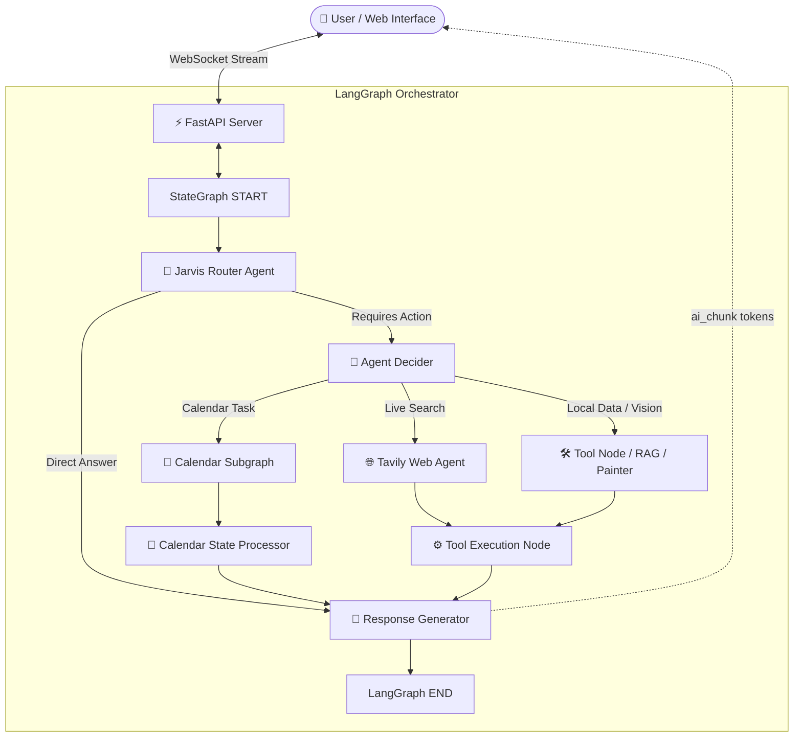

# ⚡ AETHER — Autonomous Multi-Agent AI System

<div align="center">
  
  <br><br>

  [](LICENSE)
  [](https://python.org)
  [](https://fastapi.tiangolo.com)
  [](https://langchain-ai.github.io/langgraph/)
  [](https://ai.google.dev/)
  [](https://github.com/AmanGupta-001/AETHER)

  <p align="center">
    <b>A stateful, graph-driven personal AI agent built for autonomous task execution, real-time live intelligence, and bi-directional calendar management.</b>
  </p>
</div>

---

## 🌟 The Vision & USP (Unique Selling Proposition)

Most AI chatbots today are **static text predictors**—they wait for a prompt, call an LLM in a single pass, and return a wall of text. If a tool fails, or if multi-step reasoning is required, they hallucinate or stall.

**AETHER is fundamentally different.** It is designed from the ground up as an **autonomous multi-agent state graph**:

```
┌────────────────────────────────────────────────────────────────────────┐
│                        WHAT SETS AETHER APART?                         │
├───────────────────────────────┬────────────────────────────────────────┤
│ Traditional Chatbots          │ AETHER Autonomous Assistant            │
├───────────────────────────────┼────────────────────────────────────────┤
│ ❌ Single-turn LLM generation │ ✅ Stateful Multi-Agent LangGraph       │
│ ❌ Hallucinates past tool data │ ✅ Deterministic cyclic subgraphs      │
│ ❌ Heavy 10GB+ Docker required│ ✅ Lightweight, zero-container runtime │
│ ❌ Locked into proprietary API │ ✅ Provider-agnostic (Gemini / OpenAI) │
│ ❌ High-latency full response  │ ✅ Real-time token streaming over WS   │
│ ❌ Disconnected from real life │ ✅ Bi-directional Google Calendar sync │
└───────────────────────────────┴────────────────────────────────────────┘
```

### 💎 Core USPs

1. **Stateful Graph Orchestration with Self-Correction (LangGraph)**
   - Instead of a naive chain, AETHER uses a stateful directed acyclic/cyclic graph (DAG) with checkpoints. Agents evaluate tasks, branch into dedicated subgraphs (e.g., Calendar Execution, Web Intelligence, Vector RAG), verify outputs, and return clean states without infinite loops.

2. **Universal, Free-Tier Compatible LLM Engine**
   - Zero vendor lock-in. Engineered to run seamlessly on **Google Gemini** (`gemini-flash-lite-latest`, `gemini-2.5-flash`) via an OpenAI-compatible interface, avoiding steep API costs while maintaining lightning-fast inference times. Native OpenAI models are also supported out of the box.

3. **Bi-Directional Action Engine (Not Just Conversation)**
   - AETHER connects directly to your Google Calendar using Google Cloud service accounts. It natively parses relative dates, lists schedules with full event metadata, and books appointments autonomously.

4. **Live Web Intelligence via Tavily**
   - Bypasses static training cutoffs with real-time web search and live factual synthesis, making it aware of current events, stock prices, news, and live scores.

5. **Local-First & Fast (No Docker Bloat Required)**
   - While Docker Compose is supported, AETHER is optimized to run natively in lightweight Python 3.11+ on local consumer hardware without requiring 10GB CUDA container downloads.

6. **Cyber-Modern Glassmorphic UI with Ultra-Low Latency Streaming**
   - Custom-crafted frontend featuring real-time WebSocket token streaming, cyber badge avatars, Markdown formatting, and robust input validation.

---

## 🏗️ System Architecture



---

## ✨ Features Breakdown

- **📅 Bi-Directional Google Calendar Integration**:
  - Read upcoming events across customizable time intervals (next day, week, month).
  - Automatically handles timezone conversion, ISO formats, and missing parameters.
  - Create new meetings and calendar events using natural language.

- **🌐 Live Web Search (Tavily Engine)**:
  - Answers questions regarding live news, scores, market trends, and technical docs with source citations.

- **🧠 Local Memory & Document RAG (FAISS)**:
  - Vector similarity search over past conversations and documents using local embeddings.

- **🎨 Image Synthesis Ready (Stable Diffusion)**:
  - Integrated hooks for local Stable Diffusion WebUI (`txt2img`) image generation.

- **🛡️ Graph Recursion Safeguards**:
  - Built-in multi-execution limits, cycle checks, and state validators preventing LangGraph recursion crashes.

---

## 🚀 Getting Started

### Prerequisites
- **Python 3.11+** installed ([python.org](https://www.python.org/downloads/))
- **Google Gemini API Key** ([Google AI Studio](https://aistudio.google.com/)) *— Free tier available!*
- *(Optional)* **Tavily API Key** for live web searches ([tavily.com](https://tavily.com))
- *(Optional)* **Google Cloud Service Account JSON** for Google Calendar sync

---

### Step-by-Step Installation

#### 1. Clone the Repository
```bash
git clone https://github.com/AmanGupta-001/AETHER.git
cd AETHER
```

#### 2. Create Virtual Environment
```bash
python -m venv venv

# Windows (PowerShell):
.\venv\Scripts\Activate.ps1

# Linux / macOS:
source venv/bin/activate
```

#### 3. Install Core Dependencies
```bash
pip install -r core/requirements.txt
```

#### 4. Configure Environment Variables
Copy `.env.example` into `core/.env`:
```bash
cp .env.example core/.env
```

Edit `core/.env`:
```env
# Primary LLM API (Google Gemini Free Tier or OpenAI)
GEMINI_API_KEY=your_gemini_api_key_here
GOOGLE_API_KEY=your_gemini_api_key_here
OPENAI_API_KEY=your_gemini_api_key_here
OPENAI_BASE_URL=https://generativelanguage.googleapis.com/v1beta/openai/
GEMINI_MODEL=gemini-flash-lite-latest

# Live Web Search (Tavily)
TAVILY_API_KEY=your_tavily_api_key_here

# Google Calendar (Place your credentials.json in core/)
GOOGLE_AUTH_KEY=credentials.json
GOOGLE_CALENDAR_ID=your_email@gmail.com

PORT=3000
```

#### 5. Launch AETHER
```bash
cd core
python -m uvicorn main:app --host 0.0.0.0 --port 3000
```

Open your browser and navigate to:
👉 **`http://localhost:3000`**

---

## 📂 Repository Structure

```
AETHER/
├── core/
│   ├── ai_agents/              # LLM wrappers & WebSocket streaming engine
│   │   ├── agent.py            # Universal OpenAI / Gemini client factory
│   │   ├── WebSocketAgent.py   # Token streaming & session manager
│   │   └── model.py            # Model enumerations and configs
│   ├── graph/                  # LangGraph state machine
│   │   ├── subgraph/           # Isolated subgraphs (CalendarSubGraph)
│   │   ├── node.py             # Agent prompts, deciders & tool routers
│   │   ├── graphAgent.py       # Compiled state machine workflow
│   │   └── graphstate.py       # Pydantic & TypedDict state definitions
│   ├── static/                 # Modern Cyber Web UI
│   │   ├── index.html          # Web application entry point
│   │   ├── index.css           # Glassmorphism & cyber glow styling
│   │   ├── chat.js             # Client messaging & validation logic
│   │   └── socketEvents.js     # Real-time WebSocket handlers
│   ├── tools/                  # Autonomous tool implementations
│   │   ├── google_calendar_read.py   # Calendar reader with smart defaults
│   │   ├── google_calendar_create.py # Event creator with local timezone support
│   │   ├── web_search.py             # Tavily live web retrieval
│   │   ├── painter.py                # Stable Diffusion image generator
│   │   └── rag_search.py             # FAISS document retriever
│   ├── config.py               # Central environment loader & credential manager
│   ├── main.py                 # FastAPI server & WebSocket endpoints
│   └── requirements.txt        # Production Python dependencies
├── docs/                       # Architectural manuals and setups
├── .env.example                # Example environment template
├── .gitignore                  # Strict secret & credential exclusion
├── LICENSE                     # MIT License
└── README.md                   # Project documentation
```

---

## 🔒 Security & Privacy

- **Protected Credentials**: `.gitignore` strictly blocks all `.env`, `credentials.json`, service account keys, and token files from being committed.
- **Local Persistence**: Vector indexes and session data remain on your local disk.
- **Direct Client-to-API**: Interactions route directly between your machine and Google Gemini / Tavily endpoints without third-party proxy tracking.

---

## 🗺️ Roadmap

- [x] LangGraph multi-agent orchestration architecture
- [x] Google Gemini Flash integration with OpenAI compatibility
- [x] Bi-directional Google Calendar management
- [x] Live web search integration (Tavily)
- [x] Real-time token streaming via WebSockets
- [ ] Voice I/O support (Whisper STT + Edge-TTS)
- [ ] Offline local LLM mode via Ollama / Llama.cpp
- [ ] Multi-calendar support & Outlook integration

---

## 📜 License

Distributed under the **MIT License**. See [LICENSE](LICENSE) for more information.

---

<div align="center">
  <b>Developed with ⚡ by <a href="https://github.com/AmanGupta-001">Aman Gupta</a></b>
</div>
